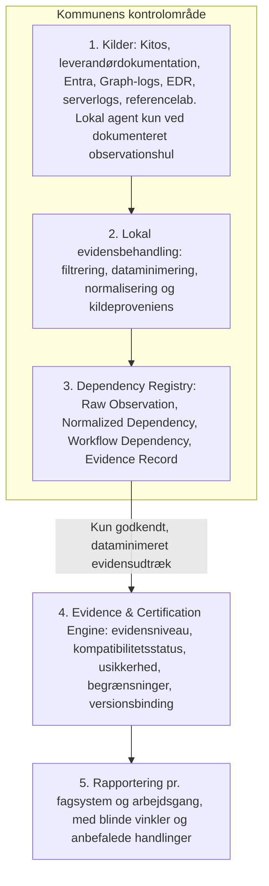

# ADR-001 – Eira overgangsarkitektur

8. november 2026

## Beslutning

Eira er en evidensmotor, som undersøger afhængigheder gennem de mindst indgribende tilgængelige kilder. Windows-agenten er en sidste udvej og ikke produktets fundament.

Værktøjet registrerer API-kald både ud fra og ind til fagsystemerne. Kald fra fagsystemer til Microsoft prioriteres først, fordi det er dem, der går i stykker ved et skift til open source.

Fagsystemets kode og konfiguration ændres ikke, men dets vej på netværket gør, og den maskine, det kører på, skal stole på Eiras certifikat. Eira indføres gradvist i kommunens eget miljø og overtager kun Microsoft-endpoints for ruter, der er verificeret efter ADR-002.

**Status:** Foreslået.

**Afløser:** Beslutningen i `docs/architecture/FINGERPRINT_DATA_FLOW.md` om en Eira-hostet pass-through-proxy i Fase A.

ADR'en fastlægger fem ting:

- Den Eira-hostede proxy udfases som primær Discovery-metode.
- Kilder vurderes på fire akser og mærkes med aktiveringsstatus.
- Entra P1/P2 og Defender er valgfrie kildeadaptere, ikke forudsætninger.
- Afhængigheder registreres uafhængigt af kommunens målplatform.
- Én samlet kompatibilitetsprocent afskaffes som primær resultatvisning.

## Kontekst

Proxyen kan ikke være fundamentet for Discovery, fordi den kræver ændret base-URL og fører rå trafik gennem Eiras infrastruktur. Den virker heller ikke for hardcodede endpoints, hvilket repoets egen dokumentation angiver.

En agent-først-model har et andet problem. Den kræver installation på medarbejderes maskiner, før Eira har leveret værdi, og Windows-hændelser kan ikke generelt afsløre, hvilke COM-metoder der kaldes.

Den grundregel gælder derfor for hele arkitekturen: fravær af en observeret hændelse er ikke dokumentation for fravær af en afhængighed.

## Arkitektur

Eira Evidence Engine består af fem lag, og kun et godkendt, dataminimeret evidensudtræk forlader kommunens kontrolområde.

Kilderne er udskiftelige adaptere. Observation, fortolkning og certificering er adskilt, så hvert fund kan føres tilbage til sin kilde.

I Fase 1 leverer Eira forespørgsler og et defineret outputformat og installerer ingen software. Kommunen udfører forespørgslerne inden for eget kontrolområde, og rå data bliver i kildesystemerne. Behandlingen har tre adskilte trin.

1. **Kildeudtræk:** Forespørgsler begrænser og filtrerer data lokalt.
2. **Normalisering:** En transformation i Eiras versionerede forespørgselspakke oversætter resultatet til det fælles evidensformat. Kommunen kører den selv.
3. **Godkendelse:** Kommunen kontrollerer og godkender det dataminimerede evidensudtræk.

Kun et dokumenteret, dataminimeret evidensudtræk kan overføres til Eira. Overførslen er ikke en forudsætning for lokal evidensbehandling.

## Adskillelse mellem lokal evidensbehandling og Eiras Control Plane

Eira må ikke blive en nødvendig mellemstation for, at kommunen kan behandle sine egne observationer.

| Spørgsmål | Svar |
| --- | --- |
| Hvad kan kommunen udføre uden forbindelse til Eira? | Køre forespørgsler, kontrollere og normalisere resultater, godkende dem og gemme evidensudtræk |
| Hvilke data må forlade kommunen? | Kun det godkendte, dataminimerede evidensudtræk. Felterne fastlægges før accept |
| Hvilke funktioner kræver Control Plane? | Forslag: levering af versionerede forespørgsler og kapabilitetsmatrix samt analyse af delte udtræk. Fastlægges før accept |
| Kan kommunen bevare og genbehandle sin evidens uden Eira? | Ja. Kommunen ejer og opbevarer udtrækkene, og de bevarer forespørgselsversion, kilde og observationsperiode |

## Overgangsforløb

Overgangen går fra observation uden indgreb til gradvis overtagelse, rute for rute. Forløbet er en kommunal beslutning pr. fagsystem.

Discovery og pass-through er to selvstændige aktiviteter. Discovery må ikke ændre DNS, routing, certifikater eller trafikveje. Pass-through er en særskilt, kommunalt godkendt overgangsaktivitet, som først må gennemføres efter en dokumenteret beslutning pr. fagsystem og en bestået forudgående risikovurdering.

ECK-OBS-kravene gælder Discovery, og ECK-TRN-kravene gælder overgangen. `verified` og accepttest er to forskellige beviser: `verified` dokumenterer ækvivalens for en rute, og accepttesten dokumenterer, at en arbejdsgang virker med fagsystemets faktiske adfærd. Overtagelse kræver begge.

| Trin | Hvad sker der | Indgreb | Kriterium for næste trin |
| --- | --- | --- | --- |
| 1. Discovery | Kilderne i kildehierarkiet viser omfang og afhængigheder | Ingen ændring af fagsystem eller trafikvej | Kommunen vælger de systemer, der skal skifte |
| 2. Pass-through | I en måned passerer kald og svar uændret gennem Eira hos kommunen, først på fagsystemets testinstans | Omdirigering kun på de valgte maskiner og et afgrænset certifikat. Fagsystemets kode og konfiguration ændres ikke | Ruterne er registreret, og perioden er dokumenteret |
| 3. Parring | Eiras svar sammenlignes med Microsofts efter ADR-002 | Isoleret testmiljø | Ruterne har en dokumenteret tilstand |
| 4. Accepttest | Fagsystemets arbejdsgange gennemføres mod Eira i test | Testmiljø | Arbejdsgangen er bestået |
| 5. Gradvis overtagelse | Eira svarer kun for verificerede ruter | Pr. rute, kan rulles tilbage | Alle nødvendige ruter er overtaget |
| 6. Drift | Nye ruter fanges og rapporteres | Fortsat kontrol | Løbende |

Periodiske kørsler, som ikke forekommer i måneden, forbliver `unknown`. De afdækkes med leverandørdokumentation og interviews med systemejere.

| ID | Krav til overgangen |
| --- | --- |
| ECK-TRN-001 | Pass-through kører i kommunens eget kontrolområde. Den Eira-hostede proxy genindføres ikke. |
| ECK-TRN-002 | Pass-through kræver en eksplicit beslutning fra kommunen pr. fagsystem og en databeskyttelsesvurdering. |
| ECK-TRN-003 | Under pass-through sendes kald og svar uændret videre, og Microsoft modtager hvert kald én gang. |
| ECK-TRN-004 | Rå kald og svar forlader ikke kommunen. |
| ECK-TRN-005 | Eiras certifikat afgrænses til de Microsoft-domæner, der overtages. |
| ECK-TRN-006 | Overtagelse af en rute kræver status `verified` og bestået accepttest efter ADR-002. |
| ECK-TRN-007 | En ukendt rute må aldrig automatisk få svar fra Eira. Den passerer til Microsoft eller stoppes efter en eksplicit driftsregel. |
| ECK-TRN-008 | Hver overtagelse skal kunne rulles tilbage. |
| ECK-TRN-009 | Omdirigering må kun gælde de valgte maskiner, så længe andre systemer stadig bruger Microsoft. |
| ECK-TRN-010 | Pass-through starter på fagsystemets testinstans. Produktion er et senere tilvalg, som kræver en særskilt beslutning fra kommunen. |

Leverandørhostede fagsystemer er uden for modellen, fordi kommunen ikke kontrollerer deres DNS eller certifikater. De rapporteres som begrænsninger.

## Kildehierarki

Kilder prioriteres efter tilgængelighed og indgreb, og rækkefølgen er ikke obligatorisk. Hver kilde er en valgfri adapter. Mangler en kilde, leverer Eira en rapport med mindre dækning og beskriver de manglende observationsmuligheder.

| Trin | Kilde | Observationsværdi (højeste evidens) | Indgreb (aktivering) | Adgang | Databeskyttelse |
| --- | --- | --- | --- | --- | --- |
| 1 | Kitos og leverandørdokumentation | E0. Inventar og dokumentation, ikke bevis for brug | Kræver adgang | Læseadgang | Systemansvarlige og andre personoplysninger dataminimeres i delt udtræk |
| 2 | Entra-konfiguration | E1. Registreringer og tilladelser, ikke brug | Kræver adgang | Afgrænset læserolle | Lav |
| 2 | Graph-aktivitetslogs | E3. HTTP-forespørgsler til Microsoft Graph, ikke fx EWS, LDAP eller lokale Office-kald | Kræver tilvalg, medmindre de allerede er slået til | Entra P1/P2, administratorrolle og en destination som Log Analytics, Storage eller Event Hubs | URI'er kan indeholde identifikatorer og skal filtreres lokalt |
| 2 | Gateway-, reverse proxy-, IIS- og integrationslogs | E3. Metode, rute og kalder for kald ind til fagsystemet, hvis logformatet har dem | Allerede aktiv eller kræver adgang. Øget logning i selve fagsystemet er ikke tilladt, jf. ECK-OBS-003 | Læseadgang hos kommunen eller leverandøren. Hostede systemer afhænger af leverandøren | URL'er kan indeholde CPR- og sagsnumre og skal filtreres lokalt |
| 3 | Defender for Endpoint | E2. Proces til vært, ingen API-ruter | Kræver adgang | Defender-licens og hunting-rettighed. Advanced Hunting viser 30 dage, og længere historik afhænger af konfiguration og licens | Enheds- og brugerdata |
| 3 | Anden EDR | Afklares pr. produkt | Kræver adgang | Afklares pr. produkt | Afklares pr. produkt |
| 3 | AD- og serverlogs | E2. Fx usikre LDAP-binds via event 2889 | Kræver tilvalg, og diagnostikken belaster domænecontrolleren | Serveradministrator | Klient-IP og kontonavn |
| 3 | Sysmon | E2. Proces- og forbindelseshændelser | Indbygget version på Windows 11 og Windows Server 2025: kræver tilvalg. Standalone: kræver installation | Lokal administrator eller central styring | Enheds- og brugerdata |
| 4 | Referencelab | E4. Reproduceret adfærd for testede arbejdsgange, ikke interne metodekald | Kræver installation i laboratoriet. Instrumentering er ikke tilladt | Testlicens og leverandørens accept | Kun syntetiske data |
| 5 | Lokal Eira-agent | E2. Proces til vært, proces til fil eller DLL og udvalgte systemhændelser, hvis telemetrikilden understøtter det | Kræver installation | Lokal administrator og samtykke fra kommunen | Høj. Kræver særskilt vurdering |

Aktiveringsstatus har fem værdier:

| Status | Betydning |
| --- | --- |
| Allerede aktiv | Kan undersøges uden ny teknisk installation eller konfiguration |
| Kræver adgang | Data findes, men kommunen skal give en afgrænset læseadgang |
| Kræver tilvalg | En eksisterende platform skal konfigureres til at levere data |
| Kræver installation | Ny software eller agent skal installeres |
| Kræver instrumentering | Applikationen eller dens runtime skal instrumenteres. Ikke tilladt, jf. ECK-OBS-010 |

Status er en egenskab ved kilden hos den enkelte kommune. Tabellen viser standardprofilen, og Eira registrerer den faktiske status pr. kommune.

Sysmon findes nu som [indbygget valgfri funktion](https://learn.microsoft.com/windows/security/operating-system-security/sysmon/overview) på Windows 11 og Windows Server 2025, men er stadig ikke aktiv som standard. Ældre maskiner kræver standalone-versionen.

Agentens observationsværdi er begrænset til dokumenterede hændelsestyper og den konkrete telemetrikildes dækning. Den må ikke markedsføres som generel metode- eller funktionssporing.

Dækningsstatus holdes adskilt fra aktiveringsstatus. Aktivering siger, om kilden kan anvendes, og dækning siger, hvor meget af det relevante område den dokumenterer.

| Dækningsstatus | Betydning |
| --- | --- |
| Ikke vurderet | Dækningen er endnu ikke undersøgt |
| Ingen data tilgængelige | Kilden giver ingen brugbare data for området |
| Delvis dækning | Data mangler for bestemte maskiner, perioder eller systemer |
| Dokumenteret dækning | Kildens dækning af området er beskrevet og afgrænset |

Manglende data må ikke forveksles med manglende afhængigheder.

Kildeprofilens fire akser er uafhængige. Aktiveringsstatus og dækningsstatus må ikke ændre evidensniveauet. Evidensniveauet bestemmes alene af, hvad kilden faktisk dokumenterer.

## Afhængigheder og scenarier

Dependency Registry skal rumme fire retninger. Et skift rammer de tre første direkte, mens kald ind til fagsystemet typisk består, medmindre login eller hosting også skifter.

| Retning | Eksempel | Bedste kilder |
| --- | --- | --- |
| Fagsystem → Microsoft-tjeneste | Graph, EWS, LDAP, Entra-login | Konfiguration, Graph-logs, serverlogs |
| Klient → Office/Windows | Word-fletning, COM, DLL'er | Referencelab, derefter telemetri |
| Office → fagsystem | Outlook-journalisering, add-ins | Inventar og referencelab |
| Andre systemer → fagsystem | Integrationer mod fagsystemets API | Gateway-, reverse proxy-, IIS- og integrationslogs |

Arkitekturen gør ikke Linux til en skjult forudsætning. Tre spørgsmål holdes adskilt:

1. **Nuværende afhængigheder:** Hvad bruger kommunens fagsystemer faktisk i dag?
2. **Ønsket målplatform:** Hvilke Microsoft-afhængigheder ønsker kommunen at reducere eller fjerne?
3. **Migreringsscenarie:** Hvad skal kunne fungere på Windows, Linux eller begge?

Det første spørgsmål besvares af Discovery. De to andre er input til vurderingen, så samme afhængighed kan have forskellig status i forskellige scenarier.

En registreret afhængighed skal mindst kunne knyttes til:

- Fagsystem, leverandør og fagsystemversion
- Afhængighedstype og retning
- Microsoft-produkt eller målkomponent
- Arbejdsgang, hvis den er kendt
- Kilde og observationsperiode
- Evidensniveau og dækningsbegrænsninger

Det gør det muligt at se forskel på to versioner af samme fagsystem, hvor kun den ene bruger en bestemt Office-integration.

## Evidens og kompatibilitet

Evidensniveau og kompatibilitetsstatus er to separate dimensioner, og ukendt bliver aldrig automatisk til gap.

| Niveau | Betydning | Binding |
| --- | --- | --- |
| E0 | Oplyst | Kilde og dato |
| E1 | Konfigureret | Kilde og dato |
| E2 | Forbindelse observeret | Kilde og observationsperiode |
| E3 | Operation observeret | Kilde og observationsperiode |
| E4 | Reproduceret i test | Konkrete versioner, testbetingelser og arbejdsgang |
| E5 | Verificeret mod målplatformen | Konkrete versioner, testbetingelser, arbejdsgang og migreringsscenarie |

E4 dokumenterer alene, at en konkret arbejdsgang er reproduceret under de angivne testbetingelser. Det dokumenterer ikke, at alle interne kald, afhængigheder eller arbejdsgange er identificeret, eller at hele fagsystemet er kompatibelt med målplatformen.

Alle rapporter viser evidensniveau og dækningsstatus hver for sig, også når et fund har høj evidens. E4 for en arbejdsgang må aldrig fremstå som dokumentation for hele systemet.

Kompatibilitetsstatus vurderes pr. afhængighed og migreringsscenarie:

- Verificeret
- Delvist verificeret
- Gap
- Ukendt

Status ses i relation til arbejdsgangens betydning. Et sjældent årsafslutningskald kan være vigtigere end tusind daglige, ukritiske forespørgsler.

## Bindende krav

Kravene gælder hele Discovery. ECK-OBS-004 er omformuleret, og 011–019 er nye.

| ID | Krav |
| --- | --- |
| ECK-OBS-001 | Discovery må ikke kræve DNS-ændringer. |
| ECK-OBS-002 | Discovery må ikke kræve ændret routing eller proxyopsætning. |
| ECK-OBS-003 | Discovery må ikke kræve ændringer i eksisterende fagsystemers kode eller konfiguration. |
| ECK-OBS-004 | Primær observation og lokal evidensbehandling skal ske uden indgreb i fagsystemernes drift, kode, konfiguration eller trafik og inden for kommunens eget kontrolområde. |
| ECK-OBS-005 | Eira må ikke ændre observerede kald eller trafik. |
| ECK-OBS-006 | Observation, fortolkning og certificering skal være separate processer. |
| ECK-OBS-007 | Rå observationer og følsomme data skal som udgangspunkt forblive inden for kommunens kontrolområde. |
| ECK-OBS-008 | Alle fund skal indeholde kilde, evidensniveau og kendte begrænsninger. |
| ECK-OBS-009 | Ukendte eller utilgængelige observationsområder skal rapporteres som ukendte, ikke som fraværende afhængigheder. |
| ECK-OBS-010 | Hooking, injection og anden instrumentering er forbudt i produktion. I et isoleret referencelab gælder forbuddet også. |
| ECK-OBS-011 | Lokal observation og evidensbehandling må ikke have Control Plane som forudsætning. |
| ECK-OBS-012 | Hver kilde skal have en kildeprofil med observationsværdi, indgreb, adgang, databeskyttelse og aktiveringsstatus. |
| ECK-OBS-013 | Ingen enkelt licens eller sikkerhedsprodukt må være en forudsætning for at levere en rapport. |
| ECK-OBS-014 | Ukendt må aldrig automatisk blive til gap. |
| ECK-OBS-015 | En lokal agent må kun tages i brug mod et dokumenteret observationshul, som de øvrige kilder ikke kan lukke. |
| ECK-OBS-016 | Hver kilde skal have en dækningsstatus adskilt fra sin aktiveringsstatus. |
| ECK-OBS-017 | En registreret afhængighed skal kunne identificeres og versionsbindes efter de felter, der er angivet under Afhængigheder og scenarier. |
| ECK-OBS-018 | Aktiveringsstatus og dækningsstatus må ikke ændre evidensniveauet. |
| ECK-OBS-019 | Alle rapporter skal vise evidensniveau og dækningsstatus hver for sig. |

## Konsekvenser for repoet

Proxy-koden udfases som primær Discovery-metode, mens tenant-, audit- og ingest-delene bevares. Vurderingen bygger på repoets stand ved commit `5fa7a0d`.

| Område | Handling | Ændring |
| --- | --- | --- |
| Tenants, medlemskaber, audit, BFF og service-auth | Genbruges | Bruges til kommuner, adgang og sporbarhed |
| `fingerprint.service.ts` | Genbruges | Allowlist-princippet og `/unknown` bliver mønster for kildeadaptere |
| `capability-matrix.v0.json` | Ændres | Udvides fra 13 Graph-ruter til afhængighedstyper, retninger og migreringsscenarier |
| `checkSupport` og `SupportLevel` | Ændres | Får værdien ukendt, så manglende match ikke bliver `gap` |
| `fingerprint_log` | Ændres | `path_raw`, `req_headers` og `payload_hash` fjernes og afløses af Dependency Registry |
| `compatibility-report.types.ts` og disclaimer | Ændres | Score-objektet afløses af status pr. afhængighed, og teksten om Compatibility Score omskrives |
| `score.ts` | Udfases | Samlet procent og grøn/gul/rød anbefaling bliver ikke primær visning |
| `apps/api/src/proxy` og `onboarding` | Udfases | Proxyflowet er ikke Discovery. Koden kan genbruges til pass-through hos kommunen efter ADR-002 |
| `FINGERPRINT_DATA_FLOW.md` og README, afsnit om deployment | Afløses | Henviser til denne ADR |
| `ECK_Fingerprinting_Architecture_v0.1.md` | Afløses | Filen er tom og erstattes af Discovery Methodology |
| `KUBERNETES_SAAS.md` og `tools/generate-envoy-config.mjs` | Gennemgås | Afklar, hvad der afhænger af proxyen |
| `packages/translation` og `packages/adapters` | Uberørt | Uden for Discovery |

## Konsekvenser og fravalg

Eira kan levere værdi, før kommunen installerer software på endpoints, men dækningen vil variere mellem kommuner.

| Konsekvens | Betydning |
| --- | --- |
| Dækning | Afhænger af kommunens kilder og skal stå tydeligt i rapporten |
| Produktløfte | Eira lover dokumenterbar indsigt med mindst mulig adgang, ikke fuld opdagelse |
| Omkostning | Referencelab kræver testmiljøer, licenser og leverandørers accept |
| Kode | Den Eira-hostede proxy stopper, og score- og datamodel skal bygges om |

Fravalgte alternativer:

| Alternativ | Hvorfor fravalgt |
| --- | --- |
| Eira-hostet proxy som primær metode | Kræver base-URL-ændring og fører rå trafik gennem Eira |
| Windows-agent først | Højeste byrde før første værdi og uden bevis på metodeniveau |
| Netværksovervågning og TLS-inspektion | Fravalgt som Discovery-metode, fordi den griber ind i trafikken. Pass-through er en særskilt beslutning pr. fagsystem i overgangen |

## Før ADR'en kan accepteres

Disse punkter skal afklares, før status ændres til Accepteret.

- [x] Fastlæg, hvad der kører lokalt i Fase 1 uden installation på endpoints.
- [ ] Beslut, hvor Normalized Dependency, Workflow Dependency og Evidence Record hostes.
- [ ] Få databeskyttelsesvurdering af endpoint-data pr. medarbejder hos kommunens DPO.
- [ ] Afklar leverandørvilkår for test i referencelab.
- [ ] Definér forespørgsler, outputformat, lokal normalisering og godkendelse.
- [ ] Fastlæg, hvilke felter der må deles i evidensudtrækket.
- [ ] Fastlæg, hvilke funktioner der kræver Control Plane.

Repoets dokumentation og datamodel opdateres først, når disse beslutninger er truffet. Status forbliver Foreslået indtil da. Næste dokument er Discovery Methodology v1.0, som bliver bindende under ADR-001 og definerer, hvad Eira kan og ikke kan konkludere.

## Kilder

- [Microsoft Graph activity logs](https://learn.microsoft.com/nl-nl/graph/microsoft-graph-activity-logs-overview)
- [DeviceNetworkEvents](https://docs.microsoft.com/en-us/windows/security/threat-protection/microsoft-defender-atp/advanced-hunting-devicenetworkevents-table)
- [Eksport fra Advanced Hunting (SOC Prime)](https://socprime.com/?p=56502)
- [Indbygget Sysmon](https://learn.microsoft.com/windows/security/operating-system-security/sysmon/overview)
- [Event 2889 og LDAP-diagnostik](<https://learn.microsoft.com/en-us/previous-versions/windows/it-pro/windows-server-2008-R2-and-2008/dd941849(v=ws.10)?redirectedfrom=MSDN>)
- [OS2kitos-integration](https://os2rollekatalog.github.io/OS2rollekatalog-docs/integrations/kitos.html)
