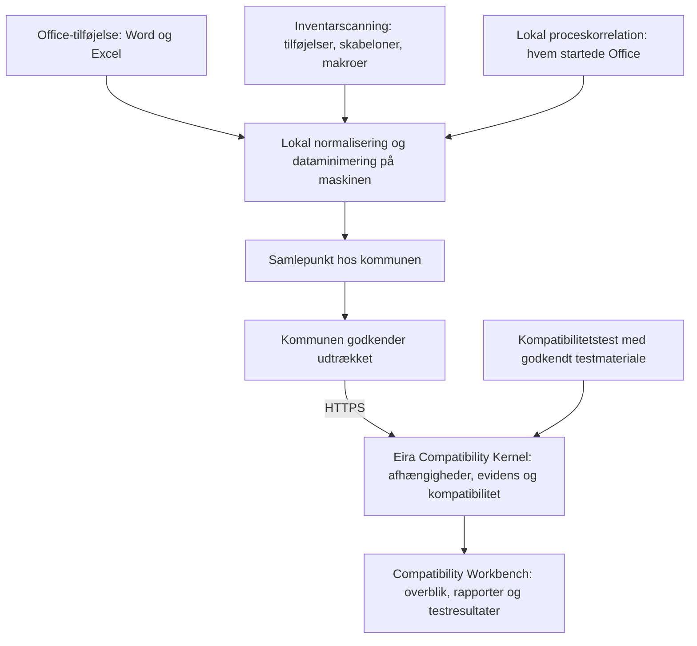

# ADR-001 – Office-centreret Discovery-arkitektur

**Status:** Foreslået.
**Dato:** 8. november 2026.
**Afløser:** Forslagene i PR #3, som lukkes uden merge. Når denne ADR er accepteret, afløser den også beslutningen om en Eira-hostet proxy i `docs/architecture/FINGERPRINT_DATA_FLOW.md`.

## Beslutning

ECK kortlægger de reelle afhængigheder mellem fagsystemer og Microsoft Office, så en kommune kan vurdere og forberede et skifte til LibreOffice uden først at udskifte sine fagsystemer.

Opsamlingen sker lokalt, med denne prioritet:

1. **Office-tilføjelse** i Word og Excel er den primære kilde.
2. **Inventarscanning** finder installationer, tilføjelser, skabeloner og makroer.
3. **Lokal proceskorrelation** kobler Office-hændelser til det program, der sandsynligvis har startet Office.
4. **Kompatibilitetstest** afgør, hvad der faktisk virker i LibreOffice.

ECK kræver ingen forhåndsliste over fagsystemer. Rapporten pr. fagsystem dannes ud fra det, der observeres.

## Kontekst

Slesvig-Holsten er det nærmeste offentlige erfaringsgrundlag. Knap 80 % af arbejdspladserne uden for skatteforvaltningen brugte LibreOffice i december 2025, og de resterende var blandt andet bundet af tekniske afhængigheder i fagsystemer. Digitaliseringsministeren har peget på fagsystemer med Office-grænseflader, dokumentskabeloner og makroer som store tekniske udfordringer.

Disse afhængigheder sker primært på maskinen, ikke på netværket. Tidligere modeller med proxy, pass-through eller opsamling af krypteret trafik er derfor fravalgt som grundlag for denne første leverance.

Grundreglen er uændret: fravær af en observation er ikke dokumentation for fravær af en afhængighed.

## Arkitektur

| Komponent | Ansvar | Må ikke |
| --- | --- | --- |
| Office-tilføjelse | Registrere hændelser og struktur i Word og Excel | Blokere brugerens arbejde eller sende indhold |
| Inventarscanning | Finde tilføjelser, skabeloner og makroer | Læse almindelige brugerdokumenter |
| Lokal proceskorrelation | Sandsynliggøre, hvilket program der startede Office | Bruge hooking eller injection |
| Samlepunkt | Lade kommunen kontrollere, hvad der deles | Kræve forbindelse til Eira for lokal brug |
| Kernel | Normalisere og vurdere | Afhænge af Windows |
| Workbench | Vise resultater | Have adgang til medarbejdernes dokumenter |

## Tekniske begrænsninger

- **Automatisering:** Office-tilføjelser kan opføre sig anderledes eller ikke indlæses, når Office startes af et program. Det er det vigtigste tilfælde for ECK og skal afklares i første tekniske test, før tilføjelsen bygges færdig.
- **Fagsystemets identitet:** Tilføjelsen kan ikke garantere at identificere det fagsystem, der startede Office. Koblingen kræver lokal procesinformation og angives som sandsynlig, indtil den er testet.
- **COM-kald:** Enkelte metodekald kan ikke observeres passivt. Hændelser som åbn og gem kan registreres, men hooking og injection er ikke tilladt.
- **Serverdannede dokumenter:** Filer, der dannes på en server og aldrig åbnes i Office, ses ikke af tilføjelsen.
- **Outlook:** COM- og VSTO-tilføjelser understøttes i klassisk Outlook, men ikke i nye Outlook til Windows. Outlook er uden for første leverance og får en særskilt strategi.
- **VBA:** VBA bruges ikke til opsamling, fordi makroer ofte er begrænsede, og fordi det er usikkert, om de kører ved automatisering.

## Data og databeskyttelse

ECK indsamler struktur og aldrig indhold.

| Datatype | Behandling |
| --- | --- |
| Dokumenttekst | Indsamles aldrig |
| Personnavne, CPR-numre og sagsnumre | Indsamles aldrig |
| Filnavne og filstier | Sendes aldrig. Kun filtype og format |
| Felter, bogmærker og indholdskontroller i almindelige dokumenter | Kun antal og type |
| Felt- og bogmærkenavne i skabeloner | Kun for skabeloner, kommunen har godkendt |
| Makroer | Kun at de findes, og hvilken type |
| Bruger-id | Sendes ikke. Ingen individuel måling af medarbejdere |
| Programnavn og version | Må sendes |
| Tidspunkt | Kun aggregeret pr. periode |

Udtræk dannes efter en positivliste over tilladte felter. En ekstra kontrol stopper værdier, der ligner CPR-numre, mails eller navne. Struktur kan undtagelsesvis stadig afsløre personoplysninger, så kommunen skal gennemføre en konsekvensanalyse før pilot. Roller som dataansvarlig og databehandler skal afklares juridisk før pilot.

## Evidens

Evidensniveau, dækning og kompatibilitet er tre adskilte dimensioner.

| Niveau | Betydning |
| --- | --- |
| E0 | Oplyst af leverandør eller dokumentation |
| E1 | Fundet i inventar |
| E2 | Sandsynlig kobling observeret |
| E3 | Hændelse observeret i Office |
| E4 | Reproduceret i test |
| E5 | Verificeret i LibreOffice under angivne betingelser |

E4 og E5 er bundet til versioner af fagsystem og Office eller LibreOffice, testmateriale og arbejdsgang. Et bestået testforløb dokumenterer kun den pågældende arbejdsgang.

Kompatibilitetsstatus er `verificeret`, `delvist verificeret`, `gap` eller `ukendt`. Ukendt bliver aldrig automatisk til gap. Der vises ingen samlet kompatibilitetsprocent.

## Bindende krav

| ID | Krav |
| --- | --- |
| ECK-OCD-001 | Fagsystemers kode og konfiguration ændres ikke. |
| ECK-OCD-002 | Tilføjelsen må aldrig være en forudsætning for, at Office eller et fagsystem virker. Ved fejl stopper opsamlingen, og brugeren kan arbejde videre. |
| ECK-OCD-003 | Dokumentindhold, personnavne, filnavne og filstier må ikke forlade maskinen. |
| ECK-OCD-004 | Almindelige dokumenter undersøges ud over antal og type kun efter særskilt godkendelse. |
| ECK-OCD-005 | Hooking, injection og trafikopfangning er ikke tilladt. |
| ECK-OCD-006 | Opsamlingen er tidsbegrænset og kan afinstalleres centralt. |
| ECK-OCD-007 | Lokal opsamling og kontrol må ikke have forbindelse til Eira som forudsætning. |
| ECK-OCD-008 | Kommunen godkender hvert udtræk, før det overføres. |
| ECK-OCD-009 | Alle fund angiver kilde, evidensniveau, dækning og kendte begrænsninger. |
| ECK-OCD-010 | Områder, der ikke kunne observeres, rapporteres som ukendte. |
| ECK-OCD-011 | Licens- og adgangskontroller må ikke omgås. |
| ECK-OCD-012 | Der føres revisionslog over indsamling, godkendelse og overførsel. |

## Første leverance

Første leverance omfatter Word, Excel, skabeloner, makroer og dokumentudveksling. Rapporten skal for hvert observeret program kunne vise:

- Hvilke Office-komponenter der bruges.
- Hvordan programmet sandsynligvis kommunikerer med Office.
- Hvilke dokumentformater, skabeloner og makroer der indgår.
- Hvad der er testet i LibreOffice, og med hvilket resultat.
- Hvad der er ukendt.

## Teststrategi

1. **Teknisk spike:** Afklar i en isoleret Windows-opsætning, hvordan tilføjelsen opfører sig, når Word og Excel startes af et andet program.
2. **Testcases:** Afprøv opsamlingen på repræsentative integrationstyper: ESDH, social og omsorg samt økonomi. De er testcases, ikke en liste over understøttede systemer.
3. **Dokumentkontrakt:** Sammenlign struktur og funktion for godkendte skabeloner i Word og LibreOffice.
4. **Databeskyttelse:** Test med syntetiske persondata, at ingen værdier findes i lokale køer, udtræk, logs eller overførsler.
5. **Fejltest:** Test, at nedbrud i tilføjelsen eller samlepunktet ikke påvirker Office.

## Acceptkriterier

ADR'en kan accepteres, når:

- [ ] Den tekniske spike viser, om tilføjelsen kan bruges ved automatisering, eller beskriver alternativet.
- [ ] Positivlisten over felter er fastlagt.
- [ ] Kommunens og Eiras databeskyttelsesroller er vurderet juridisk.
- [ ] Mindst én kommune har vurderet, om opsamlingsmodellen kan godkendes.
- [ ] Metoden til lokal proceskorrelation er valgt uden hooking.
- [ ] Strategien for Outlook er beskrevet eller eksplicit udskudt.

## Konsekvenser for repoet

| Område | Konsekvens |
| --- | --- |
| Tenants, medlemskaber, audit, BFF og service-auth | Kan genbruges |
| Kapabilitetsmatrix | Idéen genbruges. Indholdet skal handle om Office og LibreOffice |
| `score.ts` | Bruges ikke til primær visning |
| `checkSupport` | Skal kunne skelne mellem ukendt og gap |
| `apps/api/src/proxy` og `onboarding` | Bruges ikke i denne retning. Fjernes først efter accept |
| Office-tilføjelse, inventar, proceskorrelation og samlepunkt | Nye komponenter |

Ingen kode ændres, før denne ADR er accepteret.

## Fravalgte alternativer

| Alternativ | Hvorfor fravalgt |
| --- | --- |
| Eira-hostet proxy | Kræver ændret base-URL og fører rå trafik gennem Eira |
| Pass-through hos kommunen | Stort sikkerhedsmæssigt indgreb, før kommunen har fået værdi |
| Router- og NetFlow-logning som hovedkilde | Viser forbindelser, men ikke Office-afhængigheder |
| Bred Windows-agent | Større end nødvendigt og sværere at få godkendt |
| Delt bibliotek som forudsætning | Kræver viden om systemerne på forhånd |

Parring af netværkskald mod åbne standarder kan genoptages i en særskilt ADR, hvis kortlægningen viser et reelt behov.

## Kilder

- [Slesvig-Holsten: Digital suverænitet er mulig og økonomisk](https://www.schleswig-holstein.de/DE/landesregierung/ministerien-behoerden/I/_startseite/Artikel2025/IV/251204_cds_digitale_souveraenitaet)
- [Interview med Dirk Schrödter, eGovernment](https://www.egovernment.de/klares-bekenntnis-zu-open-source-a-52ca3321df2210b16247e09ba65f11f4/)
- [Microsoft: Outlook-tilføjelser i nye Outlook til Windows](https://learn.microsoft.com/en-us/office/dev/add-ins/outlook/one-outlook)
