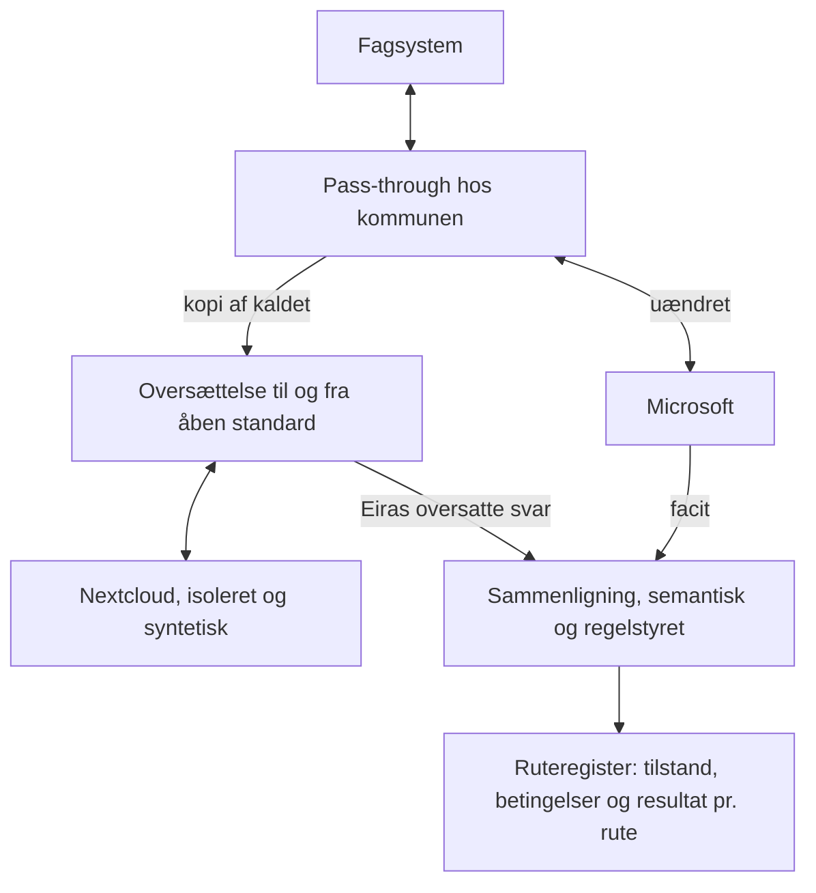

# ADR-002 – Parringsmotoren

8. november 2026

## Beslutning

Microsofts faktiske svar er facit for, om Eira svarer korrekt. Eira må kun overtage en rute, når dens oversatte svar er dokumenteret ækvivalent med Microsofts under angivne betingelser.

**Status:** Foreslået.

**Relateret:** ADR-001 fastlægger overgangen. Denne ADR er den normative kontrakt for måling af kompatibilitet.

Fagsystemets kode og konfiguration ændres ikke. Parringsmotoren afgør kun, hvilke ruter Eira kan overtage i kommunens eget miljø.

## Sådan virker parringen

Fagsystemet taler stadig med Microsoft, mens Eira afprøver sin oversættelse ved siden af.

Oversættelsen af en rute skrives én gang og kan genbruges på tværs af kommuner. Parringen viser, om den holder hos den enkelte kommune.

## Tre testmodeller

De tre modeller holdes adskilt, så skrivende kald aldrig udføres to gange, og sammenligningen kan gentages.

| Model | Hvad sker der | Hvad den beviser |
| --- | --- | --- |
| Pass-through | Microsoft modtager det oprindelige kald én gang, og svaret returneres uændret | Hvilke ruter der bruges, og hvordan svarene er opbygget |
| Skyggetest | Eiras oversættelse afprøves mod en isoleret Nextcloud-instans med tilsvarende syntetisk tilstand | At den oversatte rute er ækvivalent med facit |
| Accepttest | Fagsystemets faktiske arbejdsgang gennemføres i testmiljøet | At fagsystemet accepterer svarene, og at bivirkninger virker |

Produktionstrafik kan kun give strukturelt facit, fordi rigtige data ikke findes i den isolerede instans. Semantisk facit kræver, at samme kald køres mod en Microsoft-testtenant og en Nextcloud-instans med identiske syntetiske data.

En Microsoft-testtenant med syntetiske data er et krav i piloten. Uden den kan en rute ikke blive `verified`.

Skrivende kald (`POST`, `PUT`, `PATCH`, `DELETE`) køres kun mod isolerede testmiljøer. Webhooks, fillåse og afsendt mail ses ikke i svaret og afprøves i accepttesten.

## Testkontrakt

En parring er kun reproducerbar, hvis testdata og skrivende kald følger faste regler.

Det fælles syntetiske testdatasæt skal definere:

- Entiteter og relationer.
- Identitetsmapping mellem Microsoft og Nextcloud.
- Tidsstempler og tidszoner.
- Rettigheder og adgangsforhold.
- Tomme felter og manglende værdier.
- Fejltilstande.
- Paginering og ændringer over tid.

Skrivende kald i test skal opfylde:

- Nyt eller gendannet testdatasæt før hver testserie.
- Ingen delte produktionsidentiteter eller produktionsdata.
- Kontrol af sideeffekter uden for HTTP-svaret.
- Test af gentagne kald og idempotens.
- Dokumenteret oprydning efter testen.

Eira gentager aldrig automatisk et skrivende kald ved timeout, hverken i test eller under pass-through. En timeout beviser ikke, at operationen ikke er udført.

## Rutetilstande

En rute har præcis én tilstand pr. kombination af betingelser, og kun `verified` kan give overtagelse.

| Status | Betydning |
| --- | --- |
| `unknown` | Ruten er ikke undersøgt |
| `observed` | Kaldet er set, men ikke parret |
| `paired` | Begge svar er indsamlet |
| `verified` | Sammenligning bestået under dokumenterede betingelser |
| `diverged` | En relevant forskel er fundet |
| `blocked` | Ruten må ikke overtages af Eira |

| Testresultat | Tilladt status |
| --- | --- |
| Kun observeret trafik | `observed` |
| Begge svar indsamlet | `paired` |
| Strukturel sammenligning bestået | Stadig `paired` |
| Semantisk test bestået under dokumenterede betingelser | Kan blive `verified` |
| Relevant forskel | `diverged` |

En strukturel sammenligning må aldrig alene føre til `verified`. Kan en rutes nødvendige semantiske test ikke gennemføres, kan den ikke blive `verified`.

Regler:

- En ukendt rute må aldrig automatisk få et svar fra Eira. Den passerer til Microsoft eller stoppes efter en eksplicit driftsregel.
- Når Microsoft-tjenesten er lukket, kan en ukendt rute kun stoppes med en tydelig fejl.
- `blocked` sættes ved beslutning og ophæves kun ved beslutning.
- Overtagelse kræver `verified` og en bestået accepttest for den arbejdsgang, ruten indgår i.

En `verified`-status er bundet til:

- Microsoft API-version og endpoint.
- Eiras oversættelsesversion.
- Nextcloud-version og konfiguration.
- Fagsystem og fagsystemversion.
- Testperiode og testdatasæt.
- Sammenligningsregler og godkendte afvigelser.

Ændres en af betingelserne, falder ruten tilbage til `observed`, indtil den er parret og sammenlignet igen.

Versionsbinding garanterer ikke uændret adfærd, fordi Microsoft kan ændre sig uden ny versionsangivelse. Derfor gælder:

- `verified` har en verificeringsdato og en fastlagt genverificeringsperiode.
- Kritiske ruter kan kræve tidligere genverificering.
- Ændringer i oversættelsesregler udløser genverificering.
- Kan en rute ikke genverificeres inden fristen, vises den som forældet verificering. Den må ikke overtages på ny.
- Microsoft-testtenanten skal bevares, så længe genverificering er nødvendig.

`verified` dokumenterer ækvivalens for en rute under bestemte betingelser. Accepttesten dokumenterer, at en konkret arbejdsgang virker med fagsystemets faktiske adfærd. Overtagelse kræver begge.

## Semantisk sammenligning

To svar er kun ækvivalente, hvis de har samme betydning og funktion, ikke blot samme felter.

| Område | Krav |
| --- | --- |
| Statuskode | Skal stemme. `404` og `200` er ikke ækvivalente, selv om klienten kan håndtere begge |
| Felter og datatyper | Skal stemme for alle felter, medmindre en godkendt regel siger andet |
| Delta-link | Skal bevare sin funktion og give de faktiske ændringer |
| ETag | Skal understøtte den forventede konflikt- og cacheadfærd |
| Paginering | Skal give samme komplette datasæt og korrekt fortsættelse |
| Id'er | Eira vedligeholder en stabil oversættelse mellem Microsofts og Nextclouds id'er |
| Fejlsvar | Fejlkode og struktur skal svare til Microsofts |

Sammenligningen starter strengt. En afvigelse må kun accepteres gennem en eksplicit regel, som er testet, versioneret, begrundet og godkendt.

## Dokumentkontrakt

Dokumentkontrakten er en specialiseret anvendelse af samme princip: Microsofts dokumentresultat er facit, og LibreOffice og Eira skal bestå de samme strukturelle og funktionelle accepttests.

Kontrakten udledes pr. arbejdsgang af filer, der virker i dag, og dækker:

- Filtype og OOXML-variant.
- Flettefelter, bogmærker, indholdskontroller og custom XML.
- Dokumentegenskaber, som fagsystemet læser.
- PDF-version og layoutkrav.

Det, fagsystemet sender, kontrolleres før åbning i LibreOffice. Det, LibreOffice gemmer, kontrolleres, før fagsystemet får det. Kendte afvigelser rettes kun efter testede regler, og en fil, der ikke kan bringes i overensstemmelse, afleveres ikke som korrekt.

## Forbehold og konsekvenser

En verificeret rute er ikke bevis for fuld kompatibilitet med Microsoft. Den er bevis for kompatibilitet for de observerede kald, testede tilstande og den konkrete versionskombination.

**Databeskyttelse:** Rå kald og svar bliver hos kommunen. Kun rutemønstre og resultater må deles. Det kræver en databeskyttelsesvurdering før pilot.

| Område i ECK-repoet | Konsekvens |
| --- | --- |
| `packages/translation` | Bliver oversættelseslaget for parringen. Graph-delen dækker i dag kun brugere |
| `packages/capability` | `native` og `emulate` tillades kun for `verified`-ruter. Øvrige ruter bliver `coexist` eller `reject` |
| `packages/adapters` | Runtime-adaptere skal færdiggøres for de ruter, profilen viser |
| `apps/api/src/proxy` | Kan genbruges til pass-through, som kører hos kommunen |
| Ruteregister | Nyt. Gemmer tilstand, betingelser og sammenligningsresultat |
| Sammenligningsmotor og afvigelsesregler | Nye komponenter |

## Før accept

Disse punkter skal afklares, før status ændres til Accepteret.

- [ ] Fastlæg, hvor mange observationer en rute kræver for at blive `paired`.
- [ ] Fastlæg, hvordan rutemønstre udledes uden at gemme rå stier.
- [ ] Fastlæg, hvem der godkender afvigelsesregler.
- [ ] Fastlæg opbevaring og sletning af rå svar under pass-through.
- [ ] Gennemfør databeskyttelsesvurdering for pass-through.
- [ ] Afprøv hele modellen på én arbejdsgang i ét fagsystem.
- [ ] Fastlæg genverificeringsperioden og hvilke ruter der er kritiske.
- [ ] Fastlæg, hvad der sker med en allerede overtaget rute, når verificeringen forældes.
- [ ] Definér det fælles syntetiske testdatasæt.
